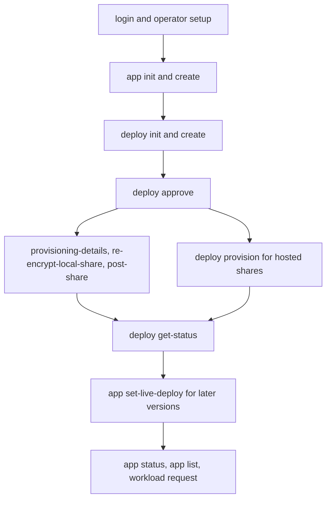

# TVC verification map

This is the maintained map of TVC user journeys. Select the affected commands
below. A smoke result covers only the entry points it drives, not an entire row.

API credentials authenticate requests. Operators approve manifests. Quorum keys
protect encrypted app state. The CLI composes these roles through this flow:

Provisioning is conditional on the workload and quorum setup. The first
deployment targets automatically. `deploy status` inspects configuration and
approvals; `deploy get-status` reports runtime readiness. The CLI uses the
workspace's API client and stamper plus QOS cryptography; see
[TVC dependencies](../../../../Cargo.toml) and the linked lifecycle guide.

| Feature | Entry points | Baseline |
| --- | --- | --- |
| [Identity and tools](identity-and-tools.md) | `login`, `profile delete`, `operator create`, `version`, `skills save` | Offline tools; test organization for authentication |
| [Applications](applications.md) | `app init`, `create`, `list`, `status`, `set-live-deploy`, `delete` | Template locally; app and deployment for live checks |
| [Deployment lifecycle](deployment-lifecycle.md) | `deploy init`, `create`, `approve`, `status`, `get-status`, `debug-logs`, `delete`, `restore` | Fixture signing locally; image and API for deployment |
| [Quorum and provisioning](quorum-and-provisioning.md) | `keys init-local-quorum-key`, `generate-local-quorum-key`, `create-quorum-key`, `re-encrypt-local-share`, `backup-operator-key`; `deploy provisioning-details`, `provision`, `post-share` | Local keys or hosted operators; fresh bundle for attestation |
| [YubiKey](yubikey.md) | `yubikey create-certs`, `unregister`, `keys refresh-yubikey`; `operator create --kind yubikey` | Disposable registered hardware for live device checks |

## Baseline preconditions

Run from the Rust workspace root. Use the [helper](../scripts/verify.sh) to build
and drive a fresh child home. The CLI has no persistent local server. Never use
ambient `TVC_*` inputs or the user's profiles for fixture verification.
Integration tests own their loopback servers and temporary fixtures.

Connected recipes use shell variables populated from actual CLI responses.
`app_id`, `deploy_id`, `operator_id`, `quorum_key_id`, and `share_operator_id`
must belong to the dedicated test organization. `app_config` and `deploy_config`
must be filled configs, not placeholder templates. Keep credentials and private
keys out of transcripts. Missing prerequisites are a blocked journey, not a pass.

## Driving conventions

`verify.sh test TARGET [FILTER]` runs existing `assert_cmd`, `rexpect`, and HTTP
boundary tests. Capture this evidence separately from live behavior. Follow the
[bundled lifecycle guide](../../../../skills/tvc-deployments/references/deploy-lifecycle.md)
for the connected sequence and the current binary's help for arguments.
Do not replace a failing journey with a more convenient entry point.

## Proof and skip reporting

Report the feature ID, exact entry point, command, exit code, resulting state,
and evidence directory. Mutation proof includes a second read or file check.
Record paths that were not exercised and why. Synthetic attestations and API
fixtures do not prove live Nitro validation, hardware, readiness, or traffic.
